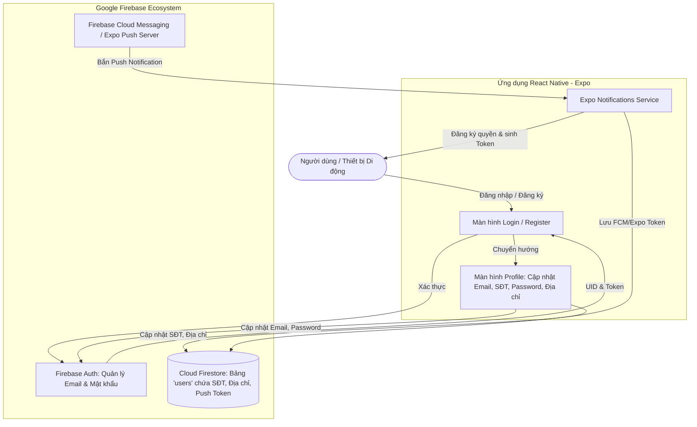

# Kế Hoạch Triển Khai Dự Án: Ứng Dụng Quản Lý Người Dùng & Push Notification Với Firebase (MMA301)

## 📌 1. Tổng Quan Dự Án & Mục Tiêu

### 1.1. Bối cảnh & Yêu cầu đề bài
Xây dựng một ứng dụng di động hoàn chỉnh sử dụng hệ sinh thái **Firebase** đáp ứng 3 mục tiêu cốt lõi:
1. **Đăng nhập & Quản lý thông tin người dùng**:
   - Xác thực người dùng (Đăng ký, Đăng nhập, Đăng xuất) qua Firebase Authentication.
   - Cho phép người dùng xem và cập nhật toàn bộ thông tin cá nhân bao gồm: **Email, Số điện thoại, Mật khẩu, Địa chỉ**.
2. **Cài đặt dịch vụ FCM (Firebase Cloud Messaging) / Push Notification**:
   - Cấu hình ứng dụng để nhận được thông báo đẩy (Push Notification) từ Firebase / FCM Server.
   - Đăng ký và lưu trữ Device Push Token của người dùng lên cơ sở dữ liệu.
   - Xử lý thông báo khi app đang mở (Foreground), chạy ngầm (Background) và khi chạm vào thông báo.
3. **Nộp link online**:
   - Đảm bảo ứng dụng chạy mượt mà trên nền tảng trực tuyến như **Expo Snack** (`snack.expo.dev`) hoặc Web Hosting (Firebase Hosting / Vercel), cho phép người chấm mở trực tiếp và quét mã QR kiểm thử trên thiết bị thật.

### 1.2. Công nghệ đề xuất (Tech Stack)
- **Framework ứng dụng**: React Native (Expo SDK 52/54+)
- **Nền tảng Cloud Backend**: Google Firebase:
  - **Firebase Authentication**: Quản lý tài khoản, Email/Password, phiên xác thực.
  - **Cloud Firestore**: Lưu trữ dữ liệu hồ sơ người dùng mở rộng (`phoneNumber`, `address`, `fcmToken`, `updatedAt`).
  - **Firebase Cloud Messaging (FCM) / Expo Push Service**: Gửi và nhận Push Notification đa nền tảng (Android/iOS/Web).
- **Thư viện chính**:
  - `firebase` (v10 modular SDK / tương thích tốt với Snack)
  - `expo-notifications` & `expo-device`
  - `@react-navigation/native` & `@react-navigation/native-stack`
  - `react-native-paper` / Vector Icons (tối ưu UI/UX hiện đại)

---

## 🏛️ 2. Kiến Trúc Hệ Thống & Luồng Dữ Liệu

### 2.1. Sơ đồ luồng dữ liệu (Architecture Flow)


### 2.2. Thiết kế Cơ sở dữ liệu (Firestore Schema)
Bộ sưu tập `users`: Mỗi tài khoản được định danh bằng Document ID tương ứng với `uid` từ Firebase Auth:
```json
{
  "uid": "AbC123XyZ...",
  "email": "user@example.com",
  "fullName": "Nguyễn Văn A",
  "phoneNumber": "0987654321",
  "address": "123 Đường Nguyễn Tri Phương, Quận 10, TP.HCM",
  "pushToken": "ExponentPushToken[xxxxxxxxxxxxxx]",
  "createdAt": "2026-10-22T23:30:00Z",
  "updatedAt": "2026-10-22T23:45:00Z"
}
```

---

## 📁 3. Cấu Trúc Thư Mục Đề Xuất (Folder Structure)

```text
login_app/
├── docs/
│   ├── plan.md               # Kế hoạch triển khai dự án chi tiết (File này)
│   └── submission_guide.md   # Hướng dẫn nộp link online & cấu hình test
├── src/
│   ├── api/
│   │   └── firebase.js       # Khởi tạo Firebase App, Auth, Firestore
│   ├── context/
│   │   └── AuthContext.js    # Quản lý Global State trạng thái đăng nhập
│   ├── navigation/
│   │   └── AppNavigator.js   # Điều hướng (AuthStack & MainStack)
│   ├── screens/
│   │   ├── LoginScreen.js    # Màn hình Đăng nhập (Email + Password)
│   │   ├── RegisterScreen.js # Màn hình Đăng ký mới + tạo profile
│   │   ├── ProfileScreen.js  # Cập nhật: Email, SĐT, Password, Địa chỉ
│   │   └── NotificationTestScreen.js # Quản trị token & test bắn FCM
│   ├── services/
│   │   ├── authService.js    # API Auth (Login, Register, UpdateEmail, UpdatePassword)
│   │   ├── userService.js    # API Firestore (Lấy & Cập nhật Phone, Address, Token)
│   │   └── notificationService.js # Cấu hình nhận & kích hoạt Push Notification
│   └── components/
│       ├── CustomInput.js    # Ô nhập liệu có validate & icon
│       ├── CustomButton.js   # Nút bấm hiện đại có loading indicator
│       └── HeaderBar.js      # Thanh tiêu đề ứng dụng
├── App.js                    # Entry point & cấu hình Notification Listener
├── app.json                  # Cấu hình Expo (plugins, slug, project ID)
├── package.json              # Danh sách phụ thuộc
└── README.md                 # Tài liệu tổng quan dự án
```

---

## 🚀 4. Kế Hoạch Triển Khai Chi Tiết (5 Giai Đoạn)

### Giai đoạn 1: Chuẩn bị Môi trường & Khởi tạo Firebase Project
- [ ] **Bước 1.1**: Tạo Firebase Project trên [Firebase Console](https://console.firebase.google.com).
  - Bật dịch vụ **Authentication**: kích hoạt Sign-in provider `Email/Password`.
  - Bật dịch vụ **Cloud Firestore Database** (chọn chế độ `test mode` hoặc cấu hình Security Rules cho phép user đã đăng nhập đọc/ghi dữ liệu của chính họ).
  - Kích hoạt **Cloud Messaging (FCM)** và lấy thông tin Server Key / sender ID.
- [ ] **Bước 1.2**: Khởi tạo cấu trúc dự án Expo trong `login_app`.
- [ ] **Bước 1.3**: Cài đặt các gói thư viện cần thiết:
  - `firebase`: Kết nối SDK Firebase.
  - `expo-notifications`, `expo-device`: Hỗ trợ dịch vụ Push Notification.
  - `@react-navigation/native`, `@react-navigation/native-stack`: Quản lý chuyển trang.
- [ ] **Bước 1.4**: Tạo file cấu hình `firebase.js` chứa Firebase Config Keys.

---

### Giai đoạn 2: Phát triển Hệ Thống Xác Thực & Quản Lý Thông Tin Người Dùng
- [ ] **Bước 2.1**: **Đăng nhập (Login)**:
  - Giao diện nhập Email và Mật khẩu chuẩn UX/UI, có chức năng ẩn/hiện mật khẩu.
  - Xử lý xác thực bằng `signInWithEmailAndPassword`.
  - Bắt lỗi chi tiết từ Firebase: sai mật khẩu (`wrong-password`), không tìm thấy user (`user-not-found`), định dạng email sai (`invalid-email`).
- [ ] **Bước 2.2**: **Đăng ký (Register)**:
  - Nhập Email, Mật khẩu, Xác nhận mật khẩu, Họ tên, Số điện thoại và Địa chỉ.
  - Tạo tài khoản qua `createUserWithEmailAndPassword`.
  - Khởi tạo ngay document trong Firestore `users/{uid}` chứa: Họ tên, Số điện thoại, Địa chỉ, Email.
- [ ] **Bước 2.3**: **Màn hình Quản Lý Thông Tin (Profile Management)**:
  - Lấy dữ liệu người dùng từ Firebase Auth (`user.email`) kết hợp document Firestore (`phoneNumber`, `address`).
  - **Cập nhật Email**: Sử dụng hàm `updateEmail` hoặc `verifyBeforeUpdateEmail` của Firebase Auth + cập nhật lại Firestore.
  - **Cập nhật Mật khẩu**: Yêu cầu xác thực mật khẩu cũ (`reauthenticateWithCredential`), sau đó đổi mật khẩu mới bằng `updatePassword`.
  - **Cập nhật Số điện thoại & Địa chỉ**: Sử dụng `setDoc` / `updateDoc` trên Cloud Firestore.
  - Phản hồi thông báo trực quan (Alert hoặc Toast) khi cập nhật thành công hoặc gặp lỗi.
- [ ] **Bước 2.4**: **Đăng xuất (Logout)**:
  - Thực thi `signOut(auth)` và chuyển người dùng về màn hình Login.

---

### Giai đoạn 3: Tích Hợp Firebase Cloud Messaging (FCM) & Push Notification
- [ ] **Bước 3.1**: Cấu hình `expo-notifications`:
  - Khai báo Notification Handler: Cho phép hiển thị Alert và âm thanh kể cả khi ứng dụng đang ở tiền cảnh (Foreground).
  - Cấu hình Notification Channel đối với nền tảng Android (`priority: AndroidNotificationPriority.MAX`).
- [ ] **Bước 3.2**: Lấy Device Push Token & Lưu trữ:
  - Kiểm tra xem thiết bị có phải là Physical Device hay không (`Device.isDevice`).
  - Xin cấp quyền từ người dùng (`Notifications.requestPermissionsAsync`).
  - Thu thập Push Token (`Notifications.getExpoPushTokenAsync` hoặc FCM Device Token).
  - Tự động đồng bộ Push Token vào trường `pushToken` của user trên Firestore mỗi khi đăng nhập.
- [ ] **Bước 3.3**: Lắng nghe sự kiện thông báo:
  - Bắt thông báo khi app đang chạy (`addNotificationReceivedListener`).
  - Bắt hành vi người dùng click vào thông báo (`addNotificationResponseReceivedListener`) để điều hướng đến màn hình chi tiết hoặc Profile.
- [ ] **Bước 3.4**: Công cụ kiểm thử Push Notification:
  - Tạo nút gửi thông báo thử nghiệm (Local Push hoặc gọi Expo Push Server API) để giảng viên có thể test ngay trên app.
  - Hướng dẫn test gửi từ Firebase Console -> Cloud Messaging.

---

### Giai đoạn 4: Thiết Kế Giao Diện (UI/UX) Đẳng Cấp & Tối Ưu Hóa
- [ ] **Thiết kế thẩm mỹ**:
  - Tông màu hiện đại (Modern Indigo / Dark Mode accents / Bo tròn góc mềm mại).
  - Đảm bảo bàn phím không che mất các trường nhập liệu (`KeyboardAvoidingView`).
  - Trạng thái loading mượt mà trên tất cả nút bấm và thao tác bất đồng bộ.
- [ ] **Validation & Bảo mật**:
  - Kiểm tra định dạng Email bằng Regular Expression.
  - Kiểm tra độ dài mật khẩu (tối thiểu 6 ký tự theo tiêu chuẩn Firebase).
  - Kiểm tra tính hợp lệ của định dạng số điện thoại Việt Nam (10 chữ số).

---

### Giai đoạn 5: Đóng Gói, Triển Khai Trực Tuyến & Lấy Link Nộp Online
- [ ] **Phương án 1 (Ưu tiên): Triển khai lên Expo Snack (snack.expo.dev)**:
  - Khởi tạo hoặc cập nhật project trên Expo Snack.
  - Đưa toàn bộ mã nguồn `App.js`, các components, services và config Firebase vào Snack.
  - Lưu và tạo liên kết công khai (Public Shareable Link), ví dụ: `https://snack.expo.dev/@duyle/login_app`.
  - Ưu điểm: Giảng viên có thể chạy trực tiếp trên trình duyệt hoặc quét mã QR qua ứng dụng Expo Go trên điện thoại thực tế để nhận push notification ngay lập tức.
- [ ] **Phương án 2: Triển khai Web App qua Firebase Hosting / Vercel**:
  - Chạy `npx expo export -p web` để build ứng dụng dạng Web.
  - Triển khai miễn phí lên Firebase Hosting (`firebase deploy --only hosting`) hoặc Vercel.
  - Cung cấp link web online trực tiếp kèm hướng dẫn trải nghiệm.

---

## 🧪 5. Bảng Kịch Bản Kiểm Thử (Verification & Test Matrix)

| STT | Kịch bản kiểm thử (Test Case) | Các bước thực hiện | Kết quả mong đợi |
| :--- | :--- | :--- | :--- |
| **TC-01** | Đăng ký tài khoản mới | Điền đầy đủ Email, Pass, Tên, SĐT, Địa chỉ -> Bấm Đăng ký | Tài khoản được tạo trên Auth; Firestore sinh bản ghi `users/{uid}` đầy đủ thông tin. |
| **TC-02** | Đăng nhập tài khoản | Nhập đúng Email và Password vừa đăng ký -> Bấm Đăng nhập | Đăng nhập thành công, chuyển hướng vào màn hình Quản lý thông tin. |
| **TC-03** | Đăng nhập sai mật khẩu | Nhập đúng Email nhưng gõ sai Mật khẩu | Ứng dụng hiển thị thông báo lỗi rõ ràng, không bị crash. |
| **TC-04** | Cập nhật Email | Đổi sang email mới hợp lệ -> Bấm Lưu Email | Firebase Auth cập nhật email mới; Firestore đồng bộ; hiển thị thông báo thành công. |
| **TC-05** | Cập nhật Mật khẩu | Nhập mật khẩu cũ để xác thực -> Nhập mật khẩu mới -> Bấm Đổi | Đổi mật khẩu thành công; Đăng xuất và đăng nhập lại bằng mật khẩu mới thành công. |
| **TC-06** | Cập nhật SĐT & Địa chỉ | Thay đổi SĐT hoặc Địa chỉ mới -> Bấm Lưu thông tin | Firestore được cập nhật tức thì; tải lại màn hình hiển thị đúng dữ liệu mới. |
| **TC-07** | Nhận Push Token | Mở app và đồng ý quyền cấp thông báo | Token được sinh và lưu vào trường `pushToken` của user trên Firestore. |
| **TC-08** | Nhận Push Notification | Gửi thông báo từ Firebase Console hoặc nút test trong app | Thiết bị nhận được thông báo rung/chuông và hiển thị banner thông báo. |
| **TC-09** | Kiểm tra Link Online | Mở đường link nộp bài trên trình duyệt | Ứng dụng tải nhanh chóng, hoạt động đầy đủ chức năng không phát sinh lỗi module. |

---

## 📅 6. Tiến Độ & Mốc Thời Gian Triển Khai (Milestones)

```text
[Mốc 1: Khởi tạo & Cấu hình Firebase] ──> [Mốc 2: Auth & Quản lý User Profile]
                                                      │
                                                      ▼
[Mốc 5: Nộp link & Đóng gói docs] <── [Mốc 4: Tối ưu UI] <── [Mốc 3: Tích hợp FCM Push]
```

- **Mốc 1**: Hoàn thành cấu hình Firebase Auth + Firestore + Khởi tạo dự án.
- **Mốc 2**: Hoàn thành màn hình Login, Register và Profile (Update Email, Pass, Phone, Address).
- **Mốc 3**: Tích hợp xong Notification Service & Push Token handler.
- **Mốc 4**: Hoàn thiện toàn bộ giao diện theo chuẩn thẩm mỹ cao, xử lý phím và loading.
- **Mốc 5**: Triển khai trực tuyến lên Expo Snack / Web và hoàn thiện file hướng dẫn chấm bài.
